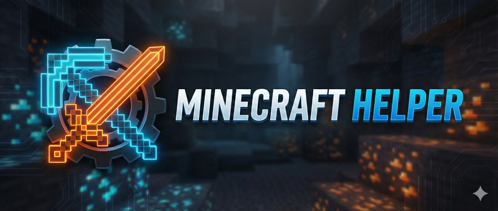
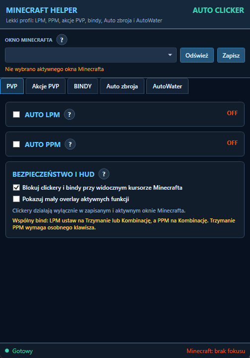
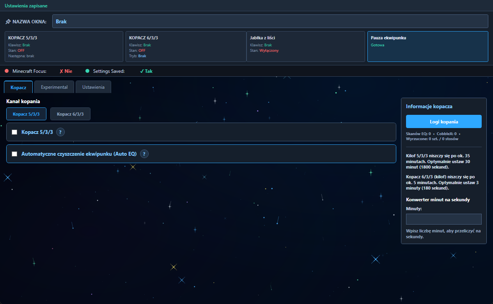
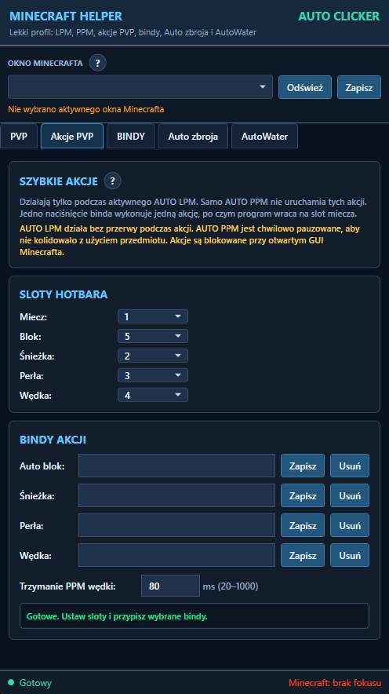
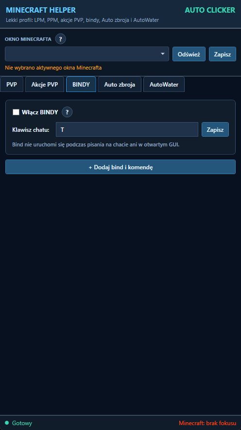
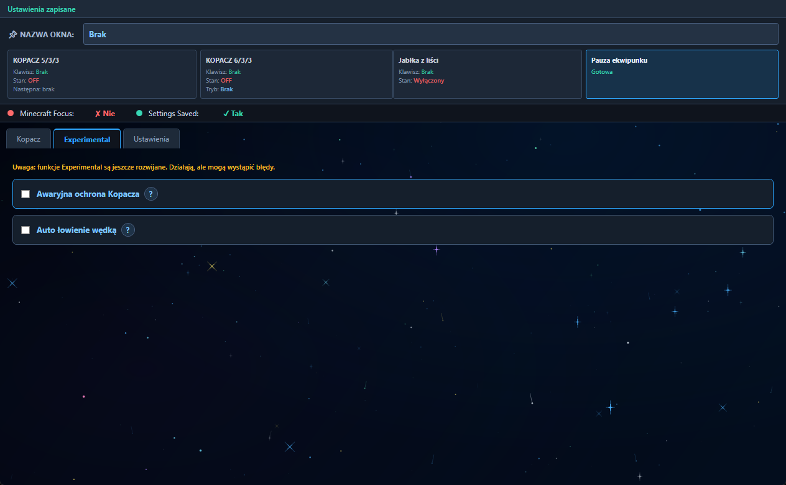
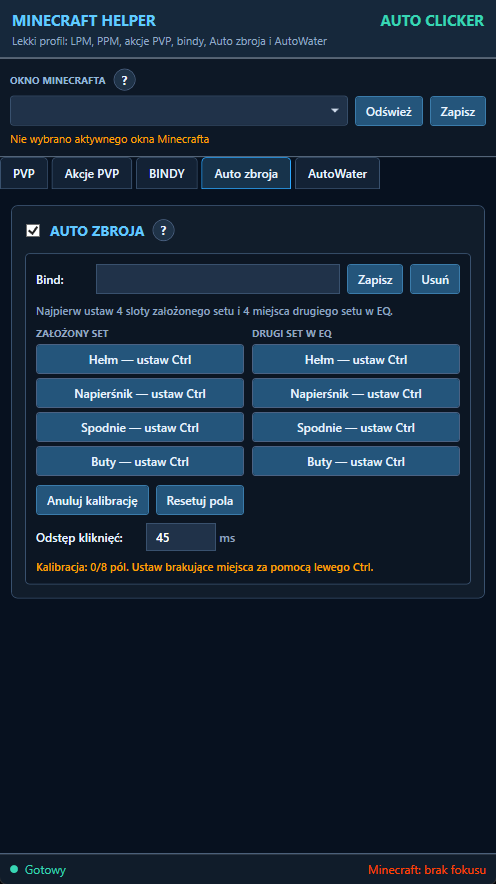
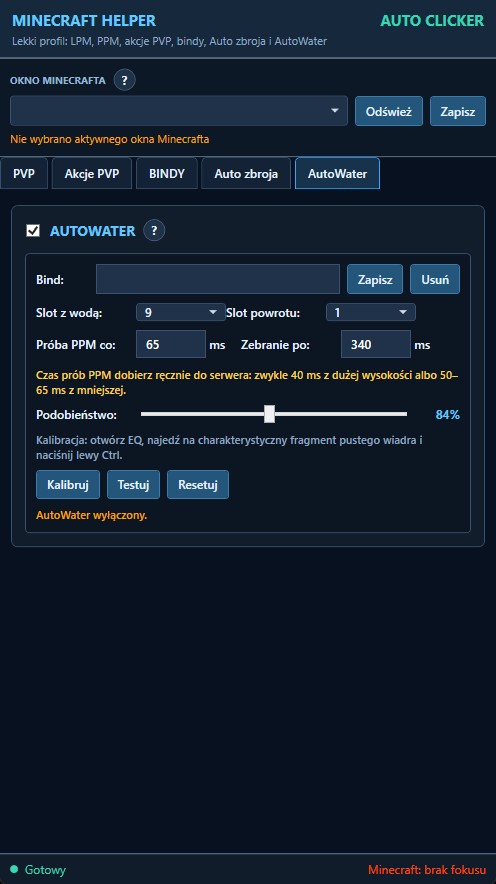
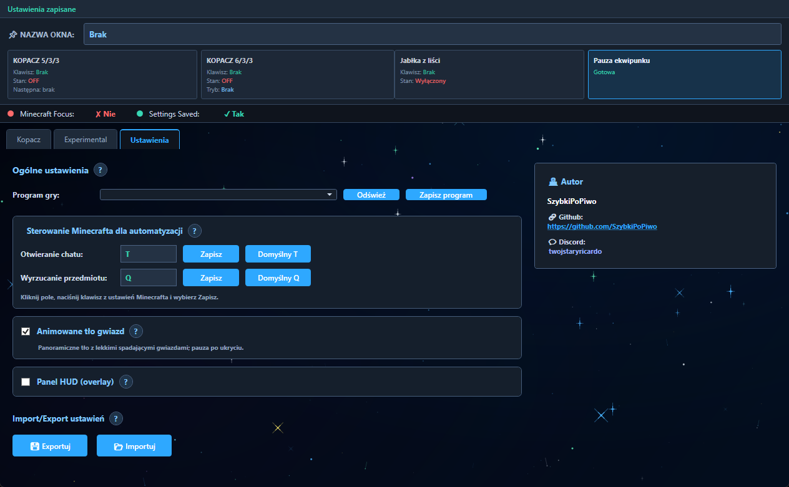

<p align="center">
  
</p>

<h1 align="center">Minecraft Helper</h1>

<p align="center">
  Dwie niezależne aplikacje: lekki Auto Clicker do PVP oraz osobny Kopacz z Auto EQ i automatyzacją dla Minecraft 1.8.8.
</p>

<p align="center">
  <strong>Windows 10/11</strong> · <strong>Minecraft 1.8.8</strong> · <strong>bez Forge i modów</strong> · <strong>wersja 2.0.2</strong>
</p>

<p align="center">
  <a href="#szybki-start">Szybki start</a> ·
  <a href="#auto-clicker--pvp-auto-lpm-i-auto-ppm">Auto Clicker</a> ·
  <a href="#kopacz-auto-eq-i-cobblex">Kopacz</a> ·
  <a href="#bindy-auto-clicker">BINDY</a> ·
  <a href="#autowater">AutoWater</a> ·
  <a href="#funkcje-dodatkowe">Funkcje dodatkowe</a> ·
  <a href="#ustawienia-i-hud">Ustawienia</a> ·
  <a href="#instalacja">Instalacja</a> ·
  <a href="#to-do">TO DO</a>
</p>

Minecraft Helper jest teraz podzielony na dwa osobne programy dla Windows. `Minecraft Helper Auto Clicker` zawiera AUTO LPM, AUTO PPM, szybkie akcje PVP, ścinanie jabłek, BINDY, Auto zbroję i AutoWater. `Minecraft Helper Kopacz` zawiera kopanie 5/3/3 i 6/3/3, Auto EQ, CobbleX, Auto Reconnect, ochronę awaryjną, autołowienie i logi. Programy nie wymagają Forge ani instalowania moda w grze.

Rozdzielenie ogranicza liczbę uruchomionych modułów. Auto Clicker nie ładuje OCR, obsługi dźwięku ani mechanizmów Kopacza, a Kopacz nie uruchamia clickerów, BINDY, Auto zbroi, AutoWater ani globalnego hooka myszy. Oba programy mogą być zainstalowane razem albo osobno.

> Program wysyła wejście z klawiatury i myszy do wybranego okna gry. Przed uruchomieniem funkcji upewnij się, że wskazany jest właściwy proces Minecrafta, a okno gry ma fokus.

## Szybki start

Jeżeli korzystasz z programu pierwszy raz:

1. [Uruchom instalator](#instalacja) i wybierz `Auto Clicker`, `Kopacz` albo oba składniki. Możesz też [uruchomić projekty ze źródeł](docs/BUILDING.md).
2. Uruchom Minecraft lub BlazingPack w wersji 1.8.8 i wejdź do gry.
3. W Auto Clickerze wybierz proces w górnej części małego okna. W Kopaczu zrób to w zakładce `Ustawienia`. Nie wybieraj launchera.
4. Kliknij `Odśwież`, wskaż właściwe okno gry i zapisz wybór.
5. Do Auto EQ, ochrony awaryjnej i Auto Reconnect zainstaluj [paczkę zasobów Minecraft Helper](#wymagana-paczka-zasobów).
6. Włącz tylko potrzebne moduły, ustaw ich bindy i sprawdź działanie w bezpiecznym miejscu.

Obie aplikacje mają własne ustawienia i mogą działać niezależnie. Zaznaczenie clickera, Kopacza lub akcji pod bindem udostępnia konfigurację; samą pracę uruchamiasz zapisanym bindem. Auto EQ i ochrona awaryjna działają razem z aktywnym Kopaczem, zgodnie ze swoimi ustawieniami. Szczegółowe podpowiedzi obu programów są dostępne pod przyciskami `?`.

Przy pierwszym uruchomieniu każdej aplikacji pojawi się jej własne okno powitalne. Po aktualizacji Auto Clicker i Kopacz pokażą listę zmian tylko raz dla nowej wersji; potwierdzenie jest zapisywane niezależnie w ustawieniach danego programu.

Przy uruchomieniu obie aplikacje sprawdzają także najnowsze publiczne wydanie na GitHubie. Jeśli dostępna jest nowsza wersja, wyświetlą numer obecnej i najnowszej wersji oraz bezpieczny link do oficjalnego instalatora. Instalator nie jest pobierany ani uruchamiany automatycznie, a brak internetu nie blokuje startu programu.

### Uruchamianie ze źródeł

Polecenia wykonuj w PowerShellu w głównym katalogu repozytorium, obok `MinecraftHelper.slnx`. Wymagane narzędzia opisano w [instrukcji budowania](docs/BUILDING.md#wymagane-narzędzia).

**Auto Clicker — makra LPM/PPM i funkcje PVP:**

```powershell
dotnet run --project ".\MinecraftHelper.Pvp\MinecraftHelper.Pvp.csproj" -c Release
```

**Kopacz — kopanie i automatyzacja:**

```powershell
dotnet run --project ".\MinecraftHelper\MinecraftHelper.csproj" -c Release
```

To aplikacje okienkowe — po uruchomieniu nie pokazują zwykłego panelu tekstowego w terminalu. Jeśli program już działa, sprawdź jego ikonę w zasobniku obok zegara. Ukrycie Helpera nie oznacza, że Minecraft może stracić fokus; gra nadal musi być aktywna.

> Opis obejmuje [zmiany w wersji 2.0.2](#zmiany-w-wersji-202). Po aktualizacji AutoWater wymaga ponownej kalibracji obu wiader.

<p align="center">
  <a href="docs/images/v2-autoclicker-pvp.png">
    
  </a>
  <a href="docs/images/v2-miner-main.png">
    
  </a><br>
  <sub>Dwie niezależne aplikacje w Minecraft Helper 2.0.2 — Auto Clicker oraz Kopacz.</sub>
</p>

## Przegląd funkcji

| Aplikacja | Zawartość |
| --- | --- |
| `Minecraft Helper Auto Clicker` | AUTO LPM, AUTO PPM, szybkie akcje PVP, ścinanie jabłek, BINDY, Auto zbroja, AutoWater i mały overlay. |
| `Minecraft Helper Kopacz` | Kopacz 5/3/3 i 6/3/3, Auto EQ, CobbleX, komendy, autołowienie, ochrona awaryjna, Auto Reconnect, HUD i logi. |

## Auto Clicker — PVP, AUTO LPM i AUTO PPM

To osobna, niewielka aplikacja z pionowym oknem. Zawiera wyłącznie funkcje PVP i nie uruchamia cięższych usług Kopacza, OCR ani nasłuchu audio.

### AUTO LPM i AUTO PPM

- `AUTO LPM` automatycznie wykonuje lewe kliknięcia.
- `AUTO PPM` automatycznie wykonuje prawe kliknięcia.
- `AUTO LPM`, `AUTO PPM` i `HOLD PPM` nie uruchomią się, gdy Minecraft pokazuje kursor ekwipunku, chatu albo innego GUI. Bind zostanie zignorowany, dzięki czemu klawisz używany podczas pisania nie zostanie przechwycony przez makro.
- Tryb pełnoekranowy jest obsługiwany: przezroczysty kursor używany przez grę nie jest mylony z kursorem otwartego GUI.
- Zakres minimalnego i maksymalnego CPS określa szybkość klikania.
- W trybie klasycznym ustawiony bind włącza clicker, a kolejne naciśnięcie go wyłącza.
- Tryb kombinacji uruchamia odpowiedni clicker po naciśnięciu przypisanego bindu razem z fizycznym LPM albo PPM i zatrzymuje go natychmiast po puszczeniu właściwego przycisku myszy. Jeden wspólny bind jest dozwolony, gdy AUTO LPM działa w trybie `Trzymanie bindu` lub kombinacji, a AUTO PPM w trybie kombinacji. Dzięki temu jeden klawisz może uruchamiać LPM, a po dołożeniu fizycznego PPM również prawy clicker. Tryb `Trzymanie bindu` dla AUTO PPM zawsze wymaga osobnego klawisza.
- Tryb `Aktywacja bindem + trzymanie LPM/PPM` działa jak trwałe uzbrojenie: jedno naciśnięcie osobnego binda włącza gotowość, a każde późniejsze trzymanie fizycznego przycisku myszy uruchamia ustawione CPS. Puszczenie LPM albo PPM natychmiast kończy klikanie bez wyłączania gotowości; ponowne naciśnięcie binda rozbraja moduł. LPM i PPM wymagają w tym trybie różnych bindów.
- Opcjonalny tryb `DAB (O)` przytrzymuje klawisz `O` tylko podczas faktycznego klikania AUTO LPM.

Najpierw zaznacz wybrany moduł, rozwiń ustawienia, przypisz bind i zapisz konfigurację. Clicker działa tylko wtedy, gdy zapisane okno Minecrafta ma fokus.

Clickery korzystają z osobnego, uśpionego harmonogramu. Pierwsze kliknięcie jest wykonywane od razu, a puszczenie wymaganego bindu lub fizycznego przycisku myszy zatrzymuje kanał przed następnym kliknięciem. Dokładniejsza rozdzielczość zegara Windows jest włączana tylko podczas faktycznego klikania. Lekki tracker fizycznego LPM/PPM uruchamia się tylko na czas trzymania przycisku w trybie kombinacji lub trwałego uzbrojenia, ignoruje kliknięcia wstrzyknięte przez aplikację i nie przetwarza ruchów myszy.

### Szybkie akcje PVP

- Zakładka `Akcje PVP` udostępnia osobne bindy dla Auto bloku, śnieżki, perły i wędki.
- Ustawiasz slot miecza oraz sloty bloku, śnieżki, perły i wędki w zakresie `1–9`.
- Jedno naciśnięcie binda podczas aktywnego AUTO LPM wybiera przedmiot, wykonuje jedno użycie PPM i wraca na slot miecza. AUTO LPM i DAB działają w tym czasie bez przerwy; chwilowo pauzowane jest tylko AUTO PPM. Samo AUTO PPM nie uruchamia szybkich akcji.
- Auto blok, śnieżka i perła wysyłają pojedyncze pełne kliknięcie PPM, bez przytrzymywania prawego przycisku między etapami. Harmonogram LPM zachowuje ustawiony CPS i termin następnego kliknięcia przez całą akcję.
- Dla wędki można ustawić czas trzymania PPM od `20` do `1000 ms`. Auto blok wybiera skonfigurowany slot bloku, stawia jeden blok i wraca na slot miecza — tak samo jak śnieżka i perła.
- Utrata fokusu, otwarte GUI albo wyłączenie clickera przerywają akcję i bezpiecznie zwalniają PPM. Aktualny etap jest widoczny w overlayu.
- Wszystkie komunikaty overlayu Auto Clickera mają jednolitą szerokość, odstępy i rozmiar tekstu; stan aktywny lub ostrzeżenie rozróżnia kolor.

<p align="center">
  <a href="docs/images/v2-autoclicker-actions.png">
    
  </a><br>
  <sub>Sloty i osobne bindy Auto bloku, śnieżki, perły oraz wędki.</sub>
</p>

### Ścinanie jabłek

- Zakładka `Jabłka` ma osobny bind uruchamiający i zatrzymujący całą pętlę.
- Ustawiasz slot nożyc i slot liści w zakresie `1–9`; domyślnie są to odpowiednio slot `1` i `2`.
- Program wybiera nożyce, trzyma LPM przez losowy czas z zakresu cięcia, przełącza się na liście i wysyła PPM ze stałą szybkością `40 CPS`, po czym wraca do nożyc.
- Osobne zakresy `od–do` w milisekundach sterują czasem przełączania slotów, trzymania LPM i kładzenia liści.
- Domyślnie co `40` pełnych cykli program wybiera slot nożyc i wykonuje komendę `/repair`. Liczbę cykli oraz treść komendy można zmienić.
- Ponowne użycie binda zatrzymuje automat natychmiast. Utrata fokusu lub nieoczekiwane otwarcie GUI przerywa pętlę i zwalnia trzymany LPM. Aktualny etap i licznik do naprawy są widoczne w overlayu.

### Pozostałe opcje

- `Pauza gdy kursor widoczny (ekwipunek/GUI)` zatrzymuje klikanie, kiedy gra pokazuje kursor. Zalecamy pozostawić tę opcję włączoną.

## Kopacz, Auto EQ i CobbleX

<p align="center">
  <a href="docs/images/v2-miner-main.png">
    
  </a><br>
  <sub>Odchudzona aplikacja Kopacz z kanałami 5/3/3 i 6/3/3, Auto EQ oraz logami.</sub>
</p>

Zakładka `Kopacz` łączy automatyczne kopanie z wykonywaniem komend oraz opcjonalnym czyszczeniem ekwipunku.

### Tryby kopania

- `Kopacz 5/3/3` — osobny kanał automatycznego kopania z bindem i listą komend wykonywanych po ustawionym czasie.
- `Kopacz 6/3/3` — osobny kanał kopania na wprost lub do góry, z konfiguracją szerokości i długości.

Kanały mają oddzielne zakładki i checkboxy konfiguracji. Kopanie uruchamia się i zatrzymuje zapisanym bindem; uruchomienie jednego kanału zatrzymuje drugi. Czasy zaplanowanych komend są liczone od rozpoczęcia cyklu, dlatego kolejne komendy powinny mieć rosnące wartości.

### Auto EQ — automatyczne czyszczenie ekwipunku

Auto EQ otwiera ekwipunek w ustalonych odstępach, rozpoznaje oznaczone przedmioty i wyrzuca całe stosy z wybranych pól przez `lewy Ctrl + ustawiony klawisz wyrzucania`.

Przed skanem program odsuwa kursor poza GUI, aby nazwa przedmiotu nie zasłoniła sąsiednich pól. Po wyrzucaniu ponownie sprawdza otwarty ekwipunek i w razie potrzeby wykonuje maksymalnie trzy przebiegi. Dzięki temu wynik obejmuje przedmioty faktycznie usunięte, a nie tylko wykonane próby naciśnięcia skrótu.

Program wyrzuca przedmioty tylko z 27 pól głównego ekwipunku. Hotbar, pancerz i crafting są zawsze pomijane przy wyrzucaniu. Kontrola bezpieczeństwa może jednak odczytać znacznik diamentowego kilofa również z hotbara. W zwykłym trybie zaznaczony typ przedmiotu oznacza „wyrzucaj”, a odznaczony „zawsze zostaw”. Opcja `Wyrzucaj wszystko z EQ` jest osobnym trybem: ignoruje wybór typów i wyrzuca każdy wykryty przedmiot z zaznaczonych slotów, pozostawiając cobblestone. Wybrane typy są zapamiętywane i wracają po wyłączeniu tego trybu. Na czas skanowania i wyrzucania pozostałe akcje Kopacza czekają.

Opcja `Zjedz mięso po Auto EQ` wykonuje dodatkowy etap po zakończeniu skanowania i ewentualnym utworzeniu CobbleX. Program zamyka ekwipunek, wybiera slot `2`, przytrzymuje PPM przez 4 sekundy, wraca na slot `1` i dopiero wtedy wznawia kopanie. Mięso musi znajdować się na drugim polu hotbara, a narzędzie do kopania na pierwszym.

#### Wymagana paczka zasobów

Rozpoznawanie przedmiotów działa z paczką:

```text
MinecraftHelper_AutoEQ_CobbleX_1.8.8.zip
```

Skopiuj plik ZIP z głównego katalogu repozytorium do poniższego folderu. Nie rozpakowuj paczki:

```text
%APPDATA%\.minecraft\resourcepacks
```

Następnie w Minecraft:

1. włącz `MinecraftHelper AutoEQ + CobbleX (1.8.8)`,
2. umieść ją nad paczką `Default`,
3. wyłącz starsze paczki Minecraft Helper, aby znaczniki się nie nakładały,
4. ustaw `GUI Scale` na `Large`.

Klawisz ekwipunku musi pozostać pod `E`. Klawisze otwierania chatu i wyrzucania przedmiotu można ustawić w zakładce **Ustawienia** (domyślnie `T` i `Q`). Lewy `Ctrl` nie może być przechwytywany przez inny skrót. Podczas skanu gra musi być widoczna, aktywna i niezasłonięta innym oknem.

#### Konfiguracja Auto EQ

1. Zaznacz `Automatyczne czyszczenie ekwipunku (Auto EQ)`.
2. Ustaw odstęp pomiędzy skanami.
3. Wybierz typy przedmiotów przeznaczone do wyrzucenia.
4. Wybierz pola głównego ekwipunku, które program ma sprawdzać.
5. Otwórz ekwipunek w grze i użyj `Test wykrywania`.
6. Sprawdź wynik testu, a następnie uruchom jeden z trybów Kopacza.

Obsługiwane oznaczenia: diament, sztabka i blok złota, sztabka i blok żelaza, emerald i blok emeraldu, obsydian, jabłko, piasek, proch, węgiel, kwarc, książka, ender perła i redstone.

### Automatyczne tworzenie CobbleX

Po włączeniu tej opcji ustaw komendę serwera — domyślnie `/cx` — oraz wymaganą liczbę pełnych stacków, domyślnie `9`.

Program liczy zwykły cobblestone z widoczną liczbą `64`. Gotowy CobbleX bez liczby 64, mossy cobblestone i wariant enchantowany nie są liczone jako materiał. Po osiągnięciu progu program kończy czyszczenie, zamyka ekwipunek, otwiera czat, wysyła komendę i wznawia kopanie.

Aktualny stan Auto EQ, licznik cobblestone i wynik ostatniego skanu mogą być pokazane w HUD.

### Logi kopania

Przycisk `Logi kopania` po prawej stronie zakładki Kopacz otwiera historię całych uruchomień Kopacza. Pierwsze uruchomienie trybu 5/3/3 albo 6/3/3 tworzy nadrzędną sesję z datą, godziną i użytym kanałem. Zatrzymanie oraz ponowne uruchomienie Kopacza rozpoczyna nową sesję.

Po rozwinięciu sesji widoczne są chronologicznie:

- kolejne automatyczne otwarcia i skany EQ,
- uruchomienie, wynik i wznowienie po Auto Reconnect,
- alarm wykrycia dźwięku obrażeń i rozpoczęcie ochrony awaryjnej,
- dołączenie do serwera, wynik kontroli kilofa oraz wykonany powrót do home,
- wznowienie poprzedniego trybu Kopacza albo bezpieczne zakończenie programu,
- kontrola stanu kopania,
- wykrycie braku diamentowego kilofa i powrót do home,
- zakończenie sesji Kopacza.

Kliknięcie konkretnego wpisu EQ pokazuje tryb wyrzucania, wybrane sloty i typy, liczbę przebiegów, faktycznie wyrzucone sztuki i stosy, podział na rodzaje przedmiotów, pozostałe elementy, wykonanie komendy CobbleX oraz wynik jedzenia po czyszczeniu. Skan jest rejestrowany także wtedy, gdy nie znaleziono niczego do wyrzucenia albo operacja została przerwana.

Kolory pozwalają szybko odczytać wynik: zielony oznacza poprawne zakończenie, żółty trwającą operację lub ostrzeżenie, czerwony błąd albo przerwanie, niebieski informacje o skanie, a złoty operacje CobbleX. Wznowienie kopania po Auto Reconnect pozostaje przypisane do tej samej sesji.

Wyszukiwarka obejmuje datę, godzinę, kanał Kopacza, status, rodzaj zdarzenia, przedmioty, komendę CobbleX i treść szczegółów. Przycisk `Zapisz raport` eksportuje aktualnie widoczne — również przefiltrowane — dane do pliku CSV albo TXT. Raport zawiera identyfikatory sesji, powiązania zdarzeń i dane automatyzacji. Okno zapisu domyślnie otwiera Pulpit.

Logi są przechowywane niezależnie od ustawień aplikacji w:

```text
%APPDATA%\Minecraft Helper\mining-logs.json
```

Wpisy utworzone przez starszą wersję mechanizmu pozostają dostępne jako samodzielne rekordy i mogą zawierać tylko liczbę stosów. Program oznacza je jako stare dane zamiast przedstawiać niedokładną liczbę sztuk.

## BINDY (Auto Clicker)

Moduł pozwala przypisać własne komendy do klawiszy. Każdy wpis może mieć osobną nazwę, bind i treść komendy. Po naciśnięciu binda program otwiera czat, wpisuje przygotowaną komendę i zatwierdza ją klawiszem `Enter`.

1. Zaznacz `Włącz moduł BINDY`.
2. Dodaj wpis, podaj jego nazwę i komendę.
3. Ustaw klawisz aktywujący.
4. Zapisz ustawienia i wróć do aktywnego okna gry.

<p align="center">
  <a href="docs/images/v2-autoclicker-binds.png">
    
  </a><br>
  <sub>Własne komendy pod bindami z ochroną przed uruchomieniem podczas pisania na chacie.</sub>
</p>

## Funkcje dodatkowe

<p align="center">
  <a href="docs/images/v2-miner-experimental.png">
    
  </a><br>
  <sub>Eksperymentalna ochrona awaryjna i automatyczne łowienie w osobnej aplikacji Kopacz.</sub>
</p>

Auto zbroja i AutoWater znajdują się w osobnej aplikacji Auto Clicker. Autołowienie, ochrona awaryjna i profile Auto Reconnect należą do aplikacji Kopacz. Są to funkcje eksperymentalne — mogą wymagać dokładniejszego ustawienia i nie zawsze zachowywać się identycznie na każdym kliencie.

### Auto zbroja

<p align="center">
  <a href="docs/images/v2-autoclicker-armor.png">
    
  </a><br>
  <sub>Osobna kalibracja założonego kompletu i drugiego zestawu w ekwipunku.</sub>
</p>

`Auto zbroja` podmienia aktualnie założony komplet pancerza z drugim setem przygotowanym w ekwipunku. Każdy element ma dwa niezależnie kalibrowane miejsca: slot założonej części zbroi oraz slot odpowiadającej jej części drugiego zestawu. Stary element trafia dokładnie w miejsce nowego, dzięki czemu po zakończeniu oba komplety są zamienione miejscami.

Konfiguracja obejmuje osiem pól: hełm, napierśnik, spodnie i buty w kolumnie `Założony set` oraz te same cztery elementy w kolumnie `Drugi set w EQ`. Każde miejsce ustawia się osobno:

1. Włącz `Auto zbroję` i ustaw jej bind.
2. Kliknij przycisk wybranego elementu w małym panelu kalibracji.
3. Przejdź do Minecrafta, otwórz ekwipunek i najedź kursorem na właściwy slot.
4. Naciśnij lewy `Ctrl`. Poprawny zapis zostanie oznaczony symbolem `✓`.
5. Powtórz czynność dla wszystkich ośmiu pól.
6. Zamknij EQ i uruchom podmianę ustawionym bindem.

Po użyciu binda program sam otwiera ekwipunek. Dla każdego elementu podnosi założoną część, zamienia ją z częścią drugiego setu i zakłada nową. Po podmianie wszystkich czterech elementów zamyka EQ. Odstęp pomiędzy kliknięciami można ustawić w zakresie `25–200 ms`; na początek zalecane jest domyślne `45 ms`.

Drugi komplet musi znajdować się dokładnie w czterech skalibrowanych miejscach. Pusty albo błędnie wskazany slot może spowodować pozostawienie odpowiedniej części zbroi w ekwipunku zamiast jej założenia. Przed normalnym użyciem wykonaj próbę w bezpiecznym miejscu.

Kalibracja jest zapisywana względem środka wybranego okna Minecrafta, dlatego samo przesunięcie okna jej nie psuje. Po zmianie rozdzielczości, rozmiaru okna, trybu pełnoekranowego albo ustawienia `GUI Scale` należy skalibrować wszystkie pola ponownie. Funkcja nie wymaga znaczników paczki Auto EQ, ponieważ korzysta z ręcznie zapisanych punktów.

Podmiana działa wyłącznie w widocznym i aktywnym oknie gry. Ponowne naciśnięcie binda zleca przerwanie, ale dla bezpieczeństwa program najpierw kończy trzy kliknięcia bieżącego elementu, aby nie pozostawić zbroi na kursorze. Overlay pokazuje kalibrowane pole, aktualny etap podmiany, następne kliknięcie oraz bezpieczne anulowanie.

### AutoWater

<p align="center">
  <a href="docs/images/v2-autoclicker-autowater.png">
    
  </a><br>
  <sub>Zrzut z wersji 2.0. Bieżący kod ma dwa przyciski kalibracji: „Kalibruj puste” i „Kalibruj wodę”.</sub>
</p>

`AutoWater` pomaga wykonać water clutch podczas spadania. Po naciśnięciu bindu wybiera slot i sprawdza wzorzec **wiadra z wodą**. Przed każdą próbą PPM odczytuje ikonę. Pierwsze rozpoznanie pustego wiadra wstrzymuje PPM; dalsze potwierdzanie nie wykonuje kliknięć. Opóźnienie `Zebranie po` liczy się od pierwszego rozpoznania pustego wiadra. Po próbie zebrania program wymaga stabilnego rozpoznania wzorca wody i dopiero wtedy wraca na ustawiony slot. Ponowne naciśnięcie bindu anuluje sekwencję.

#### Przygotowanie i kalibracja

Wymagana jest **nowa, dwuetapowa kalibracja** — stary pojedynczy wzorzec nie wystarcza. AutoWater korzysta z wyglądu Twojej paczki; nie wymaga znaczników paczki Auto EQ.

1. Wybierz i zapisz okno Minecrafta. W zakładce `AutoWater` włącz moduł, zapisz bind oraz wybierz slot wody i slot powrotu.
2. Kliknij `Kalibruj puste`, umieść puste wiadro w wybranym slocie **hotbara**, otwórz **czat, nie EQ**, najedź na charakterystyczny fragment ikony widoczny **nad polem czatu** i naciśnij lewy `Ctrl`. Cała próbka `9×9 px` musi mieścić się na ikonie. W razie braku miejsca użyj `GUI Scale: Medium` lub `Large`.
3. Kliknij `Kalibruj wodę`, umieść wiadro **z wodą** w tym samym slocie, wróć do gry, otwórz czat i naciśnij lewy `Ctrl`. Nie musisz ponownie celować kursorem — program odczytuje zapisany punkt. Jeśli wzorce są zbyt podobne, wybierz inny fragment ikony i powtórz kroki 2–3.
4. Przez `Testuj` sprawdź osobno puste wiadro, wiadro z wodą i inny przedmiot. Po każdym uruchomieniu testu wróć do gry i zamknij GUI. Odliczanie pełnych `2 s` rozpoczyna się dopiero w aktywnym Minecrafcie; ponowne otwarcie GUI albo utrata fokusu je resetują. Wynik dla obcego przedmiotu powinien być nieznany, a nie oznaczać zebrania wody.
5. Włóż wodę do wybranego slotu, zamknij czat i przetestuj bind w bezpiecznym świecie. Celuj w blok — program sam nie ustawia kamery.

Po zmianie **slotu wody**, GUI Scale, paczki lub rozmiaru okna powtórz obie kalibracje. Samo przesunięcie okna nie wymaga ponownej kalibracji. Bindy i czasy ze starszych ustawień pozostają zachowane; `Resetuj` usuwa oba wzorce.

#### Ustawienia AutoWater

| Opcja | Znaczenie |
| --- | --- |
| `Slot z wodą` | Slot hotbara `1–9` używany podczas sekwencji; domyślnie `9`. Kalibruj oba wiadra właśnie w tym slocie. |
| `Slot powrotu` | Slot wybierany po potwierdzeniu zebrania wody; domyślnie `1`. |
| `Próba PPM co` | Minimalny odstęp między próbami postawienia wody: `25–500 ms`, domyślnie `65 ms`. Niepewny odczyt wstrzymuje próby. |
| `Zebranie po` | Minimalne oczekiwanie od pierwszego rozpoznania pustego wiadra do próby zebrania: `100–1500 ms`, domyślnie `340 ms`. |
| `Podobieństwo` | Próg rozpoznawania wzorców: `70–99%`, domyślnie `84%`. Wzorzec musi też wyraźnie lepiej pasować niż drugi; niejednoznaczny wynik jest nieznany. |

`Próba PPM co` wymaga ręcznego dopasowania do konkretnego serwera. Przykłady do sprawdzenia: `40 ms` przy spadaniu z około 150 kratek albo `50–65 ms` z mniejszej wysokości. Nie są to gwarantowane wartości — wpływ mają klient, serwer i opóźnienia połączenia. Zbyt wysoki próg podobieństwa może uniemożliwić rozpoznanie; przy błędnych wynikach najpierw sprawdź punkt kalibracji.

#### Bezpieczeństwo i ograniczenia

AutoWater działa tylko przy widocznym i aktywnym oknie Minecrafta. Otwarty czat, ekwipunek, inne GUI albo utrata fokusu przerywają sekwencję. Bieżący etap jest widoczny w HUD. Kalibrację lub test można anulować przez wyłączenie modułu, bez usuwania zapisanych wzorców.

Kalibracja, test i uruchomienie AutoWater zatrzymują aktywne clickery oraz DAB. Po zakończeniu włącz potrzebne makro ponownie. Podczas sekwencji pozostałe bindy nie ingerują w sloty ani PPM; nie jest to tryb ciągłego AUTO LPM używany przez szybkie akcje PVP. Używaj standardowych klawiszy hotbara `1–9` i nie zmieniaj ręcznie slotu. Funkcja nie wykrywa spadania, nie obraca kamery i nie wznawia prób bez końca — cała sekwencja ma limit `10 s`, a zbieranie maksymalnie `6` prób.

To funkcja eksperymentalna: rozpoznana ikona jest informacją klienta, nie potwierdzeniem serwera. Jeśli odświeżenie ikony trwa dłużej niż odstęp prób PPM, dodatkowa próba przed rozpoznaniem zmiany nadal jest możliwa. Najpierw testuj w bezpiecznym świecie. [Testy i próba ręczna AutoWater](tests/AutoWater/README.md).

### Auto łowienie

`Auto łowienie wędką` obserwuje zaznaczony fragment ekranu, wykrywa ruch czerwonej końcówki spławika, zwija wędkę po potwierdzonym braniu i może ponowić rzut. Najlepszy efekt daje zaznaczenie małego obszaru bezpośrednio wokół spławika.

Po włączeniu HUD panel łowienia pokazuje godzinę rozpoczęcia i czas trwania sesji, bieżący etap detekcji, położenie spławika, liczbę brań oraz czas od ostatniego złowienia.

### Awaryjna ochrona Kopacza

`Awaryjna ochrona Kopacza` łączy wykrywanie dźwięku obrażeń, wyjście z serwera, Auto Reconnect, kontrolę kilofa oraz powrót do odpowiedniego home w jeden przebieg. Funkcja jest przeznaczona dla aktywnego Kopacza 5/3/3 lub 6/3/3 i nie uruchamia automatycznej reakcji, gdy Kopacz nie pracuje.

#### Wymagania i przygotowanie

- W `Ustawieniach` wybierz właściwy proces Minecrafta, a w Experimental profil serwera używany do powrotu.
- Używaj aktualnej [paczki zasobów Minecraft Helper](#wymagana-paczka-zasobów) ze stałymi dźwiękami obrażeń `hit1`–`hit4` i znacznikami Auto EQ. Starsze paczki Minecraft Helper powinny być wyłączone.
- Ustaw w grze `GUI Scale: Large` i sprawdź znaczniki przyciskiem `Sprawdź EQ`.
- W profilu skonfiguruj zwykły home dla poprawnego kilofa oraz osobny home używany po potwierdzeniu jego braku.
- Sprawdź automatycznie wykryte źródło dźwięku Minecrafta. Urządzenie awaryjne jest używane tylko wtedy, gdy Windows nie udostępnia sesji audio wybranego procesu gry.
- Dobierz próg podobieństwa dźwięku i najpierw wykonaj próbę przyciskiem `Testuj nasłuch (15 s)`.

`Tryb testowy` zapisuje alarm i pokazuje go w programie, ale nie zatrzymuje Kopacza ani nie wychodzi z serwera. Dopiero wyłączenie trybu testowego uzbraja prawdziwą reakcję `ESC → Disconnect`.

#### Pełny przebieg ochrony

1. Podczas aktywnego kopania program nasłuchuje dźwięku obrażeń i porównuje go ze wzorcami `hit1`–`hit4`.
2. Po wykryciu alarmu natychmiast zatrzymuje Kopacza, zwalnia trzymane klawisze, naciska `ESC` i klika `Disconnect`.
3. Po ustawionej liczbie sekund rozpoczyna odzyskiwanie połączenia, rozpoznaje ekran Minecrafta i korzysta z adresu `Direct Connect` zapisanego w wybranym profilu.
4. Po wejściu na serwer otwiera EQ i kontroluje 27 pól głównego ekwipunku oraz hotbar, korzystając ze znaczników dołączonej paczki zasobów.
5. Jeżeli wykryje diamentowy kilof, wysyła zwykłą komendę home, w razie potrzeby wybiera zapisane pole GUI, czeka na teleportację, przełącza hotbar na slot 1 i wznawia dokładnie ten tryb Kopacza, który działał przed alarmem.
6. Jeżeli potwierdzi brak diamentowego kilofa, korzysta z osobnego home `brak kilofa`, czeka na teleportację i zamyka Minecraft Helper bez wznawiania kopania.

Nasłuch obrażeń pozostaje aktywny od alarmu aż do zakończenia kontroli kilofa. Jeżeli w tym czasie ponownie pojawi się dźwięk obrażeń, procedura ponownie wykona awaryjne wyjście. Gdy ekran jest nieznany, wykryto bana albo nie udało się wiarygodnie potwierdzić układu EQ, automat zatrzymuje się bez przypadkowego klikania i bez wysyłania zastępczej komendy home.

Do czasu teleportacji ustawionego w profilu program automatycznie dodaje `2 sekundy` buforu bezpieczeństwa. Przykładowo ustawienie `10 s` oznacza, że slot 1 zostanie wybrany, a kopanie wznowione dopiero po około `12 s` od wykonania home.

#### Profile i dodatkowa kontrola Auto Reconnect

Każdy serwer może mieć osobny profil zawierający:

- nazwę profilu i adres `Direct Connect`,
- zwykłą komendę powrotu, np. `/home kopalnia`,
- informację, czy komenda otwiera GUI,
- czas oczekiwania, rozmiar GUI oraz pole, które należy kliknąć,
- czas po dołączeniu, czas teleportacji i maksymalną liczbę prób,
- osobną konfigurację powrotu po wykryciu braku diamentowego kilofa.

Edytor GUI obsługuje od 1 do 6 rzędów i od 1 do 9 kolumn. Rzędy są dodawane od dołu, a kolumny z prawej strony. Jeżeli `/home` nie ma GUI, wpisz w profilu pełną komendę — po jej wysłaniu program przejdzie bezpośrednio do oczekiwania na teleportację.

Opcjonalna kontrola Auto Reconnect może także działać podczas zaplanowanego cyklu Auto EQ. Nie otwiera ekwipunku w osobnym interwale. Jeśli gra nie otworzy EQ albo program nie rozpozna jego układu po kolejnych próbach, automat analizuje ekran i może rozpocząć odzyskiwanie połączenia.

Mechanizm rozpoznaje między innymi ekran śmierci, rozłączenie, przycisk `Reconnect`, listę serwerów oraz ekran `Direct Connect`. Ekran bana lub nieznany stan zatrzymuje automat bez dalszego klikania.

Zalecana kolejność testów profilu:

1. użyj `Rozpoznaj ekran` na ekranach rozłączenia, listy serwerów i Direct Connect,
2. uruchom `Sprawdź EQ` z aktywną paczką zasobów i `GUI Scale: Large`,
3. sprawdź oba warianty powrotu do home,
4. przetestuj wykrywanie dźwięku w `Trybie testowym`,
5. dopiero na końcu uruchom `Pełny reconnect` i uzbrój tryb realny ochrony.

> Ochrona awaryjna i Auto Reconnect wymagają widocznego, aktywnego okna gry. Nie zapewniają kopania w tle, gdy Minecraft jest zminimalizowany, zasłonięty albo działa na nieaktywnym pulpicie wirtualnym Windows. Są to funkcje eksperymentalne — przed użyciem bez nadzoru sprawdź cały przebieg na swoim kliencie i serwerze.

## Ustawienia i HUD

<p align="center">
  <a href="docs/images/v2-miner-settings.png">
    
  </a><br>
  <sub>Wybór procesu gry, sterowanie Minecraftem, HUD oraz import i eksport ustawień Kopacza.</sub>
</p>

Zakładka `Ustawienia` należy do Kopacza. Auto Clicker ma wybór procesu Minecrafta bezpośrednio u góry swojego małego okna.

W ustawieniach Kopacza dostępne są:

- `Program gry` wskazuje proces Minecrafta, do którego mają trafiać klawisze i kliknięcia.
- `Odśwież` ponownie pobiera listę uruchomionych okien.
- `Zapisz program` zapamiętuje wybrane okno gry.
- `Animowane tło gwiazd` włącza lub wyłącza lekki efekt tła w głównym oknie.
- `Panel HUD (overlay)` pokazuje stan uruchomionych funkcji na ekranie.
- HUD pozwala wybrać monitor, narożnik oraz wyłączyć animacje.
- Podczas kopania HUD aktualizuje etap pracy, godzinę startu, czas działania, bieżący skan EQ oraz łączne wyniki wyrzucania i tworzenia CobbleX.
- Podczas ochrony awaryjnej HUD pokazuje pola `Teraz` i `Następnie`, używany profil i tryb Kopacza, odliczanie do reconnectu lub końca teleportacji oraz informację, czy automat wznowi kopanie, czy zakończy program.
- `Eksportuj` zapisuje kopię konfiguracji, a `Importuj` przywraca ją z pliku JSON.

Główne okno Kopacza uruchamia się wyśrodkowane i w rozmiarze dostosowanym do monitorów 1080p. Każda aplikacja pilnuje tylko własnej pojedynczej instancji, dlatego Auto Clicker i Kopacz mogą działać równocześnie bez nadpisywania swoich ustawień.

Ustawienia zapisują się automatycznie w osobnych plikach:

```text
%APPDATA%\Minecraft Helper\
├── AutoClicker\settings.json
└── Kopacz\settings.json
```

Przy pierwszym uruchomieniu po aktualizacji dotychczasowy plik Kopacza z katalogu głównego zostanie automatycznie skopiowany do podfolderu `Kopacz`. Stary plik pozostaje na miejscu jako kopia zgodna ze starszymi wydaniami.

Nie wybieraj procesu launchera. Wskaż właściwe okno Minecrafta lub używanego klienta po wejściu do gry.

### Minimalizacja i ikona w zasobniku

- W obu aplikacjach przycisk `X` nie kończy programu — ukrywa okno w zasobniku systemowym obok zegara.
- Minimalizacja Auto Clickera również chowa go do zasobnika; minimalizacja Kopacza pozostawia jego okno na pasku zadań.
- Dwukrotne kliknięcie ikony przywraca główne okno.
- Menu pod prawym przyciskiem myszy pozwala przywrócić albo całkowicie zamknąć wybraną aplikację.
- Menu zasobnika korzysta z ciemnego motywu zgodnego z pozostałą częścią interfejsu.

Jeżeli działa Auto Clicker albo Kopacz, zamknięcie okna przyciskiem `X` pozostawia aktywne funkcje w tle. Aby całkowicie wyłączyć program, użyj opcji zamknięcia z menu jego ikony.

## Zmiany w wersji 2.0.2

Wydanie obejmuje obie aplikacje i wspólny instalator z wyborem składników. Ustawienia i bindy pozostają zachowane, ale AutoWater wymaga ponownej kalibracji pustego wiadra oraz wiadra z wodą — szczegóły w [instrukcji AutoWater](#autowater).

- Akcje PVP nie resetują harmonogramu AUTO LPM ani DAB; na czas użycia przedmiotu zatrzymuje się tylko AUTO PPM.
- Kopacz nie uruchamia globalnego hooka myszy ani starych usług clickera i jego diagnostyki. Publikacja `win-x64` pomija nieużywane biblioteki OCR `x86`.
- AutoWater rozpoznaje osobno puste wiadro i wiadro z wodą. Wymaga nowej kalibracji na hotbarze przy otwartym czacie, zamiast wskazywania punktu w EQ.
- AutoWater sprawdza ikonę przed PPM, wstrzymuje klikanie po pierwszym rozpoznaniu pustego wiadra i od tego momentu odlicza czas zebrania. Zakończenie wymaga ponownego rozpoznania wody.
- Kalibracja i test AutoWater czekają na właściwe okno gry; test odlicza pełne dwie sekundy po zamknięciu GUI. Pozostałe bindy nie przerywają sekwencji.
- Dodano wspólny skrypt [testów regresji](#testy-regresji), w tym testy ciągłości LPM podczas akcji PVP, izolacji Kopacza oraz sekwencji i kalibracji AutoWater. Testy automatyczne nie zastępują próby w grze.

## Zmiany w wersji 2.0.1

- Dodano osobny tryb trwałej aktywacji AUTO LPM i AUTO PPM: bind uzbraja moduł, a ustawione CPS działa tylko podczas fizycznego trzymania odpowiedniego przycisku myszy.
- Puszczenie LPM albo PPM zatrzymuje kliknięcia bez rozbrajania; ponowne naciśnięcie binda wyłącza moduł.
- LPM i PPM korzystają w tym trybie z oddzielnych bindów, a GUI i HUD rozróżniają stan `GOTOWY`, `ON` i `PAUZA`.
- Tracker fizycznej myszy działa wyłącznie podczas trzymania przycisku, aby samo uzbrojenie clickera nie powodowało dodatkowego obciążenia.
- Dodano osobną zakładkę `Jabłka` z bindem start/stop, wyborem slotu nożyc i liści oraz losowanymi zakresami czasu przełączania, cięcia i kładzenia.
- Kładzenie liści działa ze stałą szybkością `40 CPS`, a po domyślnie `40` cyklach program wybiera nożyce i wykonuje `/repair`.
- Zatrzymanie bindem, utrata fokusu i nieoczekiwane GUI natychmiast kończą pętlę ścinania oraz zwalniają LPM.

## Zmiany w wersji 2.0

- Rozdzielono program na dwie niezależne aplikacje: lekki `Minecraft Helper Auto Clicker` oraz `Minecraft Helper Kopacz`.
- Auto Clicker nie ładuje modułów OCR, audio ani Kopacza. Dokładny zegar kliknięć działa tylko podczas aktywnego clickera; w trybach zależnych od fizycznego LPM/PPM minimalny tracker przycisków działa podczas ich trzymania, ignorując kliknięcia syntetyczne i ruch myszy.
- Kopacz nie zawiera widoków ani aktywnych modułów AUTO LPM/PPM, BINDY, Auto zbroi i AutoWater.
- Dodano szybkie akcje PVP dla Auto bloku, śnieżki, perły i wędki, z wyborem slotów oraz automatycznym powrotem do miecza.
- Obie aplikacje otrzymały osobne ustawienia, ikony, skróty, podpowiedzi `?`, informacje o zmianach i kontrolę aktualizacji.
- Instalator pozwala wybrać Auto Clicker, Kopacza albo oba programy. Wykrywa również starą, połączoną instalację i prowadzi użytkownika przez bezpieczną migrację.
- Zaktualizowano dokumentację i wszystkie główne zrzuty interfejsu.

## Zmiany w wersji 1.1.8

- Dodano eksperymentalną Auto zbroję, która pod bindem zamienia założony komplet z drugim setem przygotowanym w ekwipunku.
- Każdy z ośmiu punktów podmiany można ręcznie skalibrować lewym `Ctrl`; konfiguracja zawiera osobne pola dla założonej zbroi i drugiego setu.
- Dodano regulowany odstęp kliknięć, bezpieczne anulowanie po zakończeniu bieżącego elementu oraz pełny podgląd kalibracji i podmiany w HUD.
- Dodano eksperymentalny AutoWater z bindem, wyborem slotu wody i slotu powrotnego oraz regulowanymi czasami prób PPM i zebrania wody.
- Dodano kalibrację pustego wiadra, test rozpoznawania oraz pełny podgląd etapów AutoWater w HUD.
- Czas prób PPM można ręcznie dopasować do wysokości, opóźnień i zachowania konkretnego serwera.
- Awaryjna ochrona Kopacza łączy wykrywanie dźwięku obrażeń, wyjście z serwera, reconnect, kontrolę kilofa i powrót do odpowiedniego home.
- Rozbudowano komunikaty, HUD i logi przebiegu ochrony awaryjnej oraz Auto Reconnect.

## Zmiany w wersji 1.1.7

- Globalna obsługa myszy działa tylko podczas aktywnej automatyzacji. Samo uruchomienie Minecraft Helper nie powinno już powodować przycięć gry.
- Bind Kopacza natychmiast kończy pracę również podczas Auto EQ, wyrzucania, tworzenia CobbleX, jedzenia, wykonywania komend i Auto Reconnect.
- Spóźnione wyniki skanowania EQ i rozpoznawania ekranów są ignorowane po zatrzymaniu lub ponownym uruchomieniu automatyzacji.
- Odliczanie zaplanowanych komend Kopacza zatrzymuje się na czas Auto EQ, CobbleX i jedzenia, a po zakończeniu rusza od zachowanej wartości.
- Logi Auto EQ mają czytelniejsze wyniki: pokazują, czy EQ było czyste, ile stosów pozostało oraz dlaczego działanie zostało przerwane.

## Zmiany w wersji 1.1.6

- AUTO PPM w trybie `Trzymanie bindu` wymaga osobnego klawisza i nie może współdzielić go z AUTO LPM.
- Puszczenie bindu natychmiast zatrzymuje AUTO LPM albo AUTO PPM, bez oczekiwania na kolejną iterację interfejsu.
- Harmonogram kliknięć sam kontroluje stan trzymanego klawisza, dlatego chwilowo zajęte GUI nie powoduje dodatkowego kliknięcia po jego puszczeniu.
- Pierwsze kliknięcie wykonywane jest od razu po aktywacji, a kolejne od początku zachowują pełny ustawiony rytm CPS.
- Przy wczytywaniu starszej konfiguracji wspólny bind AUTO PPM w trybie trzymania jest bezpiecznie usuwany, aby oba clickery nie uruchomiły się jednocześnie.

## Zmiany w wersji 1.1.5

- AUTO LPM i AUTO PPM mogą korzystać z jednego wspólnego bindu, jeżeli oba działają w trybie kombinacji albo `Trzymanie bindu`.
- Dodano jasne okno konfliktu, które wyjaśnia, jak rozdzielić wspólny bind przed wyłączeniem trybu kombinacji lub trzymania.
- Poprawiono obramowania folderów, sesji, otwarć EQ i zdarzeń automatyzacji w logach kopania. Rozwinięte poziomy są teraz wyraźnie oddzielone.
- Dodano sprawdzanie najnowszego publicznego wydania przy uruchomieniu programu.
- Po wykryciu nowszej wersji aplikacja pokazuje obecną i najnowszą wersję oraz link do oficjalnego instalatora na GitHubie.
- Aktualizacja nie jest pobierana ani uruchamiana automatycznie, a brak internetu nie blokuje startu programu.

## Zmiany w wersji 1.1.4

- AUTO LPM i AUTO PPM otrzymały dodatkowy tryb `Trzymanie bindu`. Clicker działa wtedy tylko podczas fizycznego trzymania przypisanego klawisza i zatrzymuje się natychmiast po jego puszczeniu.
- Dodano ustawienia klawisza otwierania chatu i klawisza wyrzucania przedmiotu. Automatyczne komendy oraz `lewy Ctrl + klawisz wyrzucania` działają teraz z własnym układem sterowania Minecrafta.
- BINDY nie uruchamiają komend podczas pisania ani przy widocznym kursorze czatu, ekwipunku lub innego GUI Minecrafta.
- Kopacz 6/3/3 przed zaplanowanym Auto EQ i CobbleX wraca do pozycji startowej: trzyma pełne `A` przy kopaniu na wprost albo jednocześnie `A + S` przy kopaniu do góry.
- Poprawiono utrzymywanie HUD nad oknem Minecrafta na Windows 10 oraz jego automatyczne odtworzenie po zamknięciu przez system.
- Przeprowadzono audyt aplikacji: usunięto nieużywany timer i starą analizę encji F3, martwe fragmenty kodu oraz zbędne tworzenie konfiguracji serializatora podczas zapisu ustawień i logów.
- Sprawdzono zależności NuGet — brak znanych podatności, pakietów przestarzałych i dostępnych aktualizacji.

## Zmiany w wersji 1.1.3

- Dodano lekkie, animowane tło z gwiazdami oraz możliwość wyłączenia animacji w ustawieniach.
- Ujednolicono wygląd i działanie pasków przewijania w głównym oknie, konfiguracji Auto Reconnect, logach i przewodniku pierwszego uruchomienia.
- Poprawiono przewijanie ekranów z dłuższą zawartością — kółko myszy nie przeskakuje już od razu na samą górę lub dół.
- Dopracowano układ sekcji Kopacza, obramowania kart i przyciski wyboru kanału 5/3/3 oraz 6/3/3.
- Komunikaty modułu BINDY znikają automatycznie po kilku sekundach.
- Auto EQ może osobno rozpoznawać i wyrzucać bloki złota, żelaza oraz emeraldu.
- Zaktualizowano generator paczki zasobów i wykrywanie jednolitych kolorów bloków z zachowaniem ochrony cobblestone.
- Odświeżono zrzuty ekranu i opis aktualnego interfejsu.

## Zmiany w wersji 1.1.2

- Dodano konfigurowalne profile Auto Reconnect z adresem Direct Connect, komendą powrotu, opcjonalnym GUI `/home`, wyborem pola i czasami oczekiwania.
- Po odzyskaniu połączenia program wznawia ten sam tryb Kopacza 5/3/3 lub 6/3/3, który działał przed rozłączeniem.
- Dodano kontrolę obecności diamentowego kilofa wykonywaną podczas zaplanowanego Auto EQ oraz osobny sposób powrotu do home po wykryciu problemu.
- Rozbudowano Auto EQ o niezależny tryb wyrzucania całej zawartości, wybór typów i slotów oraz opcjonalne jedzenie mięsa ze slotu 2.
- Przebudowano logi kopania: jedno uruchomienie Kopacza tworzy nadrzędną sesję, a kolejne otwarcia EQ i zdarzenia automatyzacji są widoczne w rozwijanych szczegółach.
- Logi zapisują tryb wyrzucania, przedmioty, sztuki, stosy, CobbleX, jedzenie i przebieg Auto Reconnect. Eksport CSV i TXT zawiera nowe dane sesji.
- Uporządkowano sekcję Kopacza, dodano czytelne obramowania kart i zakładek, zmniejszono domyślne okno oraz wyśrodkowano je przy uruchomieniu.
- Dodano blokadę uruchomienia drugiej kopii programu.
- Poprawiono obsługę wejścia, aby otwarte GUI Minecraft Helper nie powodowało przycięć podczas gwałtownych ruchów myszy.
- Dodano lokalny log diagnostyczny clickerów z czasami wysyłania kliknięć i opóźnieniami obsługi myszy.
- AUTO LPM i AUTO PPM nie przechwytują bindów przy widocznym kursorze Minecrafta; ograniczenie nie zatrzymuje pozostałych modułów.

## Zmiany w wersji 1.1.1

- Dodano trwałe logi kopania, w których każde automatyczne otwarcie EQ tworzy osobną sesję aktualizowaną na żywo.
- Dodano rozwijane szczegóły sesji, kolorowe statusy oraz dokładny podział wyrzuconych typów na sztuki i stosy.
- Dodano wyszukiwanie po dacie, trybie, statusie i przedmiotach oraz eksport przefiltrowanego raportu do CSV lub TXT.
- Poprawiono licznik wyrzucania: program odczytuje liczebność stosów i potwierdza wynik ponownym skanem EQ.
- Dodano automatyczne odsuwanie kursora poza ekwipunek, aby tooltip nie zasłaniał przedmiotów.
- Auto EQ może wykonać do trzech przebiegów skanowania i wyrzucania.
- Okno potwierdzenia usunięcia logów korzysta teraz z ciemnego motywu aplikacji.
- Przycisk minimalizacji pozostawia aplikację na pasku zadań. Przycisk `X` ukrywa ją w zasobniku systemowym obok zegara i wyświetla powiadomienie.
- Menu ikony w zasobniku otrzymało pełny ciemny motyw, łącznie z podświetleniem, separatorem i opcją zakończenia programu.
- AUTO PPM i HOLD PPM nie uruchamiają się przy widocznym kursorze Minecrafta.
- Poprawiono harmonogram AUTO LPM, AUTO PPM i HOLD PPM, aby ustawiona wartość CPS nie spadała przez opóźnienia timera systemowego.
- Poprawiono wykrywanie kursora w trybie pełnoekranowym — makro działa podczas rozgrywki, ale nadal zatrzymuje się po otwarciu EQ, czatu lub innego GUI.
- Rozszerzono dane HUD dla kopania i automatycznego łowienia o czas sesji oraz aktualne statystyki.

## Zmiany w wersji 1.1.0

- Dodano Auto EQ z wyborem typów przedmiotów i slotów 1–27.
- Dodano wyrzucanie całych stosów przez `lewy Ctrl + Q`.
- Dodano wykrywanie pełnych stacków cobblestone i automatyczną komendę CobbleX.
- Rozszerzono HUD o stan Auto EQ, licznik cobblestone i wynik ostatniego skanu.
- Dodano paczkę zasobów `MinecraftHelper AutoEQ + CobbleX (1.8.8)`.
- Uproszczono zakładki PVP i Experimental.
- Poprawiono stabilność clickera i niekontrolowane przesunięcia kursora.
- Dodano zwijane ustawienia modułów, ujednolicone nagłówki oraz pomoc pod przyciskami `?`.
- Dodano komunikaty pierwszego uruchomienia, changelog i kontrolę zgodności zapisanych ustawień.
- Dodano samodzielny instalator Windows.

## Kontakt i zgłaszanie problemów

Jeżeli zauważysz błąd, problem z konfiguracją albo masz propozycję nowej funkcji, opisz sytuację i podaj możliwie dużo szczegółów. Pomocne są screeny, używany klient Minecrafta, ustawienia modułu i informacja, co wydarzyło się przed błędem.

- GitHub: [SzybkiPoPiwo](https://github.com/SzybkiPoPiwo)
- Discord: `twojstaryricardo`

## Instalacja

Najprościej uruchomić instalator:

```text
MinecraftHelper-Setup-2.0.2.exe
```

Na ekranie `Wybierz składniki` instalator pozwala zaznaczyć:

- `1. Auto Clicker` — lekki program z AUTO LPM/PPM, BINDY, Auto zbroją i AutoWater,
- `2. Kopacz` — kopanie, Auto EQ, CobbleX, reconnect, ochrona awaryjna, autołowienie i logi,
- obie aplikacje jednocześnie — opcja zalecana, jeżeli korzystasz z całego zestawu.

Programy trafiają do osobnych podkatalogów i otrzymują oddzielne skróty. Instalator działa dla bieżącego użytkownika, nie wymaga osobnej instalacji .NET 8 i dodaje standardowy deinstalator Windows.

Jeżeli instalator wykryje starszą, połączoną wersję z plikiem `MinecraftHelper.exe`, przed rozpoczęciem pokaże jasny komunikat o wymaganej migracji. Po potwierdzeniu uruchomi deinstalator starej wersji, zachowa ustawienia z `AppData`, a następnie przejdzie do zwykłego kreatora z wyborem `Auto Clicker`, `Kopacz` albo obu składników. Anulowanie komunikatu nie usuwa starej instalacji.

Na komputerze bez wcześniejszej instalacji od razu pojawia się ekran wyboru składników. Kolejne aktualizacje już rozdzielonego wydania są instalowane w tym samym katalogu bez ponownego usuwania obu aplikacji; zaznaczenie składników określa, które programy mają pozostać zainstalowane.

Sumę oficjalnego pliku sprawdź w opisie konkretnego wydania na GitHubie. Dla instalatora zbudowanego lokalnie oblicz ją poleceniem:

```powershell
Get-FileHash .\artifacts\installer\MinecraftHelper-Setup-2.0.2.exe -Algorithm SHA256
```

### Windows SmartScreen i Smart App Control

Instalator nie ma komercyjnego podpisu cyfrowego, dlatego Windows 11 może potraktować go jako nierozpoznaną aplikację. Sam brak reputacji nie oznacza wykrycia wirusa, ale zawsze upewnij się, że plik pochodzi z tego repozytorium.

Jeżeli pojawi się standardowe okno Microsoft Defender SmartScreen:

1. kliknij `Więcej informacji`,
2. sprawdź nazwę pliku i wydawcę,
3. wybierz `Uruchom mimo to` tylko wtedy, gdy ufasz pobranemu plikowi.

Na części instalacji Windows 11 funkcja `Inteligentna kontrola aplikacji` (`Smart App Control`) całkowicie blokuje niepodpisane programy. Najbezpieczniejszym rozwiązaniem jest wtedy pobranie repozytorium, sprawdzenie kodu i [samodzielne zbudowanie aplikacji](docs/BUILDING.md).

Jeżeli świadomie zdecydujesz się wyłączyć Smart App Control, przejdź do `Zabezpieczenia Windows` → `Kontrola aplikacji i przeglądarki` → `Ustawienia Inteligentnej kontroli aplikacji`. Nie wyłączaj programu antywirusowego, zapory ani całego Microsoft Defendera. Ponowne włączenie Smart App Control może zależeć od wydania Windows i wymagać resetu lub ponownej instalacji systemu.

Aktualne informacje: [Inteligentna kontrola aplikacji — FAQ](https://support.microsoft.com/pl-pl/windows/security/threat-malware-protection/smart-app-control-frequently-asked-questions) oraz [Kontrola aplikacji i przeglądarki](https://support.microsoft.com/pl-pl/windows/security/windows-security-app-browser-control).

Jeżeli zabezpieczenia zgłaszają konkretne zagrożenie, a nie tylko brak reputacji wydawcy, przerwij instalację, przeskanuj plik i sprawdź kod źródłowy.

### Kod źródłowy i bezpieczeństwo

Repozytorium zawiera kod C#, interfejs, skrypty budowania instalatora, generator paczki zasobów oraz jej pliki. Możesz pobrać całość, samodzielnie przejrzeć kod i zbudować program lokalnie zamiast korzystać z gotowego instalatora.

## Budowanie ze źródeł

Pełna instrukcja znajduje się w [docs/BUILDING.md](docs/BUILDING.md).

Wymagane są Windows 10 lub 11 oraz .NET SDK obsługujący rozwiązania `.slnx` (sprawdzone na SDK `10.0.402`). Aplikacje nadal mają docelowe środowisko `.NET 8`; sam numer docelowego środowiska nie określa wymaganego SDK. Visual Studio, Rider lub Visual Studio Code są opcjonalne — polecenia działają z terminala. Inno Setup 6 jest potrzebny tylko do tworzenia instalatora.

```powershell
git clone https://github.com/SzybkiPoPiwo/MinecraftHelper.git
cd MinecraftHelper
dotnet restore .\MinecraftHelper.slnx
dotnet build .\MinecraftHelper.slnx -c Release
```

Następnie [uruchom wybraną aplikację](#uruchamianie-ze-źródeł). Każdy program ma osobną komendę; nie musisz uruchamiać obu.

### Budowanie instalatora

```powershell
.\scripts\build-installer.ps1 -Version 2.0.2 -Rid win-x64 -SelfContained:$true -Clean
```

Wynik zostanie zapisany w `artifacts/installer/MinecraftHelper-Setup-2.0.2.exe`.

### Odtworzenie paczki zasobów

Do używania Auto EQ wystarczy dołączony `MinecraftHelper_AutoEQ_CobbleX_1.8.8.zip` — nie trzeba go generować. Generator wymaga Node.js oraz **rozpakowanej paczki źródłowej** z `pack.mcmeta` i folderem `assets`. Domyślny lokalny folder `Old_Default_1.8.8` nie jest częścią repozytorium.

Można rozpakować dołączony ZIP do osobnego katalogu źródłowego i ponownie nanieść znaczniki. Przykład:

```powershell
Expand-Archive .\MinecraftHelper_AutoEQ_CobbleX_1.8.8.zip -DestinationPath .\.build-check\texture-source
node tools/build-discard-texture-pack.js .\.build-check\texture-source
```

Wynik trafia do `MinecraftHelper_AutoEQ_CobbleX_1.8.8/`; istniejące pliki w tym katalogu są nadpisywane. Szczegóły: [instrukcja budowania](docs/BUILDING.md).

### Testy regresji

Na Windows uruchom wszystkie zestawy bez otwierania gry:

```powershell
.\scripts\test.ps1
```

Jeśli PowerShell blokuje lokalne skrypty, uruchom `powershell -NoProfile -ExecutionPolicy Bypass -File .\scripts\test.ps1` — dotyczy to tylko tego procesu, bez trwałej zmiany zasad systemowych.

Sprawdzają podział aplikacji, brak globalnego hooka i starej diagnostyki w Kopaczu, zgodność ustawień, zatrzymywanie kopania i liczników podczas Auto EQ, tracker przycisków clickera, ciągłość LPM podczas akcji PVP oraz sekwencję i dwuetapową kalibrację AutoWater. Testy nie wysyłają wejścia do pulpitu ani nie zmieniają ustawień użytkownika. Test trackera na krótko rejestruje jego prawdziwy hook Windows. Zachowanie w samym Minecraft nadal wymaga próby ręcznej.

## TO DO

Planowane kierunki dalszego rozwoju:

- obsługa nowszych wersji Minecrafta,
- możliwość zminimalizowania Minecrafta i dalszego kopania w tle,
- zdalna obsługa własnego klienta Minecraft za pomocą telefonu,
- odczytywanie i prezentowanie informacji z czatu,
- dalsze testy ochrony awaryjnej i Auto Reconnect na różnych klientach oraz serwerach.

Lista przedstawia pomysły na przyszłość i nie oznacza jeszcze konkretnego terminu ich wdrożenia.
